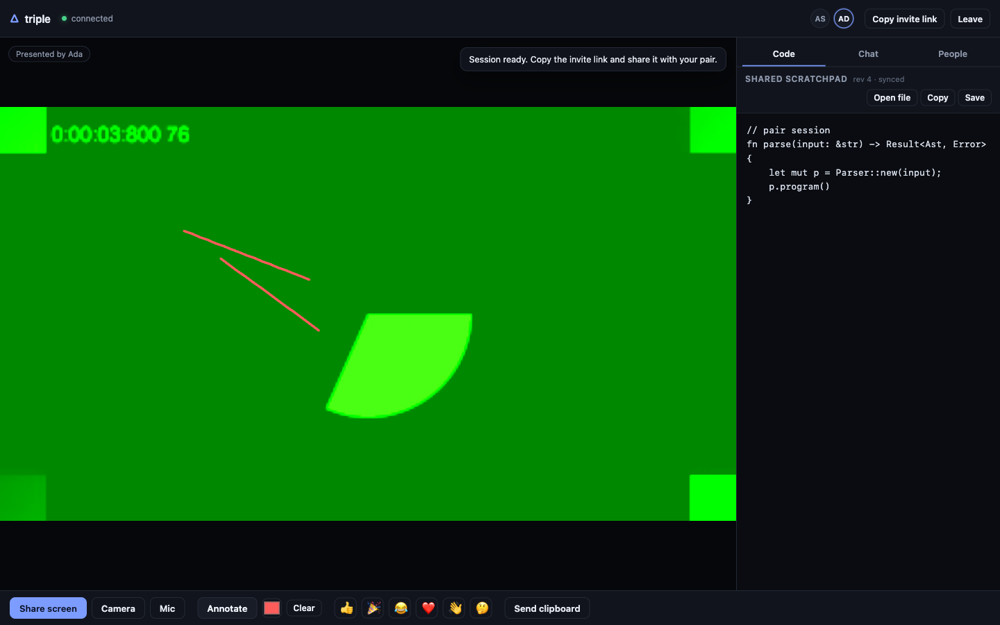

# triple

Tuple-style pair programming, built in Rust. Run one binary, hand out one
unguessable link, and pair with anyone — over the public internet, on a Wi-Fi /
LAN, or behind a whitelisted company domain. No accounts, no login, no cloud
dependency for the host.



## What works today

| Capability | Status |
| --- | --- |
| One-command host, unguessable invite link, no signup | Yes |
| Screen share with system audio (WebRTC, peer-to-peer) | Yes |
| Camera + microphone, device-level mute/stop | Yes |
| Presenter model with request-to-present and host hand-off | Yes |
| Multi-guest sessions (up to 16) with presence and join/leave toasts | Yes |
| Shared code scratchpad with server-authoritative OT and live cursors-in-editor | Yes |
| Edit policy: host-only by default, "everyone can edit" toggle | Yes |
| Per-guest control grants (request → host grant/revoke) | Yes |
| Freehand annotation over the shared screen, colour + clear | Yes |
| Remote pointer/cursor presence over a data channel | Yes |
| Emoji reactions | Yes |
| Text chat (persisted for the session, replayed to late joiners) | Yes |
| Clipboard sharing on an explicit gesture (never automatic) | Yes |
| Open / copy / save the scratchpad as a file | Yes |
| Self-signed TLS for LAN, reverse-proxy/internal-domain mode, optional cloudflared tunnel | Yes |
| STUN + configurable TURN for restrictive networks | Yes |
| Media never transits the Rust process | Yes |

### Deliberate gaps vs. Tuple

- **No OS-level remote control.** Guests cannot drive the host's desktop, apps,
  shell, or input. "Control" in triple is a consent-gated ACL over the shared
  scratchpad and annotation layer only. There is no command execution, no
  unattended access, and no screen-scraping channel.
- No recording, session history, or replay; state lives only while the host
  process runs.
- No syntax highlighting, LSP, or IDE plugin — the scratchpad is plain text with
  real OT convergence.
- No teams, orgs, persistent rooms, audit log, or auth. The invite link *is* the
  capability.
- No native app; any Chromium/Firefox/Safari with WebRTC works.
- Annotation is freehand only (no shapes, text, or export).

## Quick start

```sh
cargo run --release
```

The banner prints two URLs:

- **Host view** — open on the host machine, e.g. `http://127.0.0.1:7801/h/<hostkey>`
- **Invite link** — send to the guest, e.g. `https://192.168.1.20:7800/j/<token>`

In the default LAN mode the server generates a self-signed certificate on first
run (cached in the OS config dir) and guests accept it once. The host's own view
is served over loopback HTTP, so the host never sees a certificate prompt and
still gets a secure context for screen capture.

### Modes

| Mode | Command | TLS |
| --- | --- | --- |
| LAN / local (default) | `triple` | Self-signed, generated once, cached |
| Behind a reverse proxy or internal domain | `triple --public-url https://triple.corp.example` (or `--domain triple.corp.example`) | Terminated by the proxy |
| Public tunnel, no port forwarding | `triple --tunnel` | cloudflared quick tunnel (trusted HTTPS) |
| Plain HTTP (development only) | `triple --http` | None — remote guests lose the secure context needed for capture |

`--tunnel` needs `cloudflared` on `PATH`; if it is missing the process falls back
to LAN mode and says so.

### Configuration

Flags also read environment variables:

| Flag | Env | Default |
| --- | --- | --- |
| `--bind` | `TRIPLE_BIND` | `0.0.0.0` |
| `--port` | `TRIPLE_PORT` | `7800` |
| `--host-port` | `TRIPLE_HOST_PORT` | `7801` |
| `--public-url` | `TRIPLE_PUBLIC_URL` | — |
| `--domain` | `TRIPLE_DOMAIN` | — |
| `--tunnel` | `TRIPLE_TUNNEL` | off |
| `--http` | `TRIPLE_HTTP` | off |
| `--cert-dir` | `TRIPLE_CERT_DIR` | OS config dir |
| `--stun` | `TRIPLE_STUN` | `stun:stun.l.google.com:19302` |
| `--turn-url` | `TRIPLE_TURN_URL` | — |
| `--turn-user` | `TRIPLE_TURN_USER` | — |
| `--turn-pass` | `TRIPLE_TURN_PASS` | — |
| `--advertise-ip` | `TRIPLE_ADVERTISE_IP` | primary interface |

Example with a TURN relay for locked-down corporate networks:

```sh
TRIPLE_PUBLIC_URL=https://triple.corp.example \
TRIPLE_TURN_URL=turns:turn.corp.example:5349 \
TRIPLE_TURN_USER=triple TRIPLE_TURN_PASS=... \
triple
```

## Deployment

### Reverse proxy / internal domain

Point DNS at the machine (or its load balancer) and let the proxy terminate TLS
and forward WebSockets. Caddy:

```caddyfile
triple.corp.example {
    reverse_proxy 127.0.0.1:7800
}
```

nginx:

```nginx
location / {
    proxy_pass http://127.0.0.1:7800;
    proxy_http_version 1.1;
    proxy_set_header Upgrade $http_upgrade;
    proxy_set_header Connection "upgrade";
    proxy_set_header Host $host;
    proxy_set_header X-Forwarded-Proto $scheme;
}
```

Then run `triple --public-url https://triple.corp.example`. The process serves
plain HTTP on `--bind/--port`; invite links and the host view use the public URL.
The secure context comes from the proxy's TLS, so screen capture works.

### Media and TURN

Signalling, presence, chat, annotations, and OT go over the WebSocket. Screen,
camera, and mic are WebRTC peer-to-peer (DTLS-SRTP) between browsers. When both
peers are behind symmetric NAT or a restrictive firewall, configure TURN; the
Rust process still never carries media.

## How it works

- `src/server.rs` — axum router (embedded web assets, strict CSP), invite/host-key
  auth, WebSocket split loop.
- `src/session.rs` — participants, presenter, consent/control state, edit policy,
  chat/stroke retention, OT application and fan-out.
- `src/ot.rs` — operations, transform, apply, diff, revision history.
- `src/certs.rs` / `src/net.rs` / `src/tunnel.rs` — TLS cache, LAN address
  selection, cloudflared quick tunnel.
- `web/` — single-page client: perfect-negotiation WebRTC mesh, OT editor,
  annotation canvas, presence/consent UI.

Annotations and code edits intentionally travel over the ordered WebSocket rather
than the data channel: they need server-side convergence and late-joiner state.
The data channel carries high-frequency, loss-tolerant telemetry (pointer
position, stream-kind announcements).

### Security model

- 128-bit random invite token and a separate host key; both are required for the
  matching role, and the host key cannot be used as a guest invite.
- No shell, no OS input injection, no discovery scanning, no unattended access.
- Control is limited to the scratchpad and annotation layer, granted per guest by
  the host and revocable at any time.
- Media is encrypted end-to-end between browsers; the server sees signalling,
  presence, chat, strokes, and document operations, and persists nothing to disk.
- CSP is `script-src 'self'`; the client ships as static assets from the binary.

## Tests

```sh
cargo test
```

Covers OT transform/apply/diff convergence, tunnel URL parsing, and end-to-end
WebSocket sessions (join, chat, edit policy, consent + concurrent-edit
convergence, presenter/signalling relay, invite rejection).

Browser UI verification is manual (or Playwright-driven): join as host and guest,
share a screen, annotate, toggle edit policy, request/grant control, send a
reaction and clipboard. On macOS, the *browser* needs Screen Recording permission
for `getDisplayMedia` to deliver frames; without it the track negotiates but
carries no frames. Camera/mic use the normal per-site permission prompt.

## License

MIT. See [LICENSE](LICENSE).
